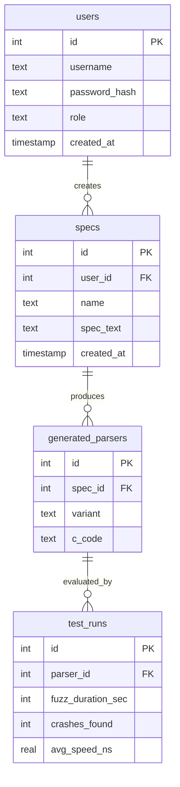

# SafeParse — Student Learning & Viva Preparation Guide

This guide is written for a second-year BIT student rebuilding SafeParse by hand file by file, understanding every design choice, and preparing to defend the project in an academic viva examination.

---

## Table of Contents
1. [Rebuild Progression Order](#1-rebuild-progression-order)
2. [File-by-File Architecture Breakdown](#2-file-by-file-architecture-breakdown)
3. [Deep-Dive on Tricky Technical Mechanisms](#3-deep-dive-on-tricky-technical-mechanisms)
   - [The Lexer State & Lookahead](#the-lexer-state--lookahead)
   - [Recursive-Descent Parsing](#recursive-descent-parsing)
   - [Unsigned Bounds Checking & Overflow Prevention in C](#unsigned-bounds-checking--overflow-prevention-in-c)
   - [The Optimizer Coalescing Pass](#the-optimizer-coalescing-pass)
   - [Relational Database Schema & Foreign Keys](#relational-database-schema--foreign-keys)
   - [Password Hashing, Cookies & Session Lifecycles](#password-hashing-cookies--session-lifecycles)
4. [Common Beginner Mistakes & Pitfalls](#4-common-beginner-mistakes--pitfalls)
5. [Analysis of Pre-Existing Test Flaws](#5-analysis-of-pre-existing-test-flaws)
6. [25 Comprehensive Viva Questions & Model Answers](#6-25-comprehensive-viva-questions--model-answers)

---

## 1. Rebuild Progression Order

When building a compiler from scratch, never start with the UI or the code generator. A compiler is a strict, unidirectional pipeline: characters become tokens, tokens become a tree, the tree is verified, transformed, and finally translated into target code.

Recreate the files in this exact sequence:

```text
[Step 1: Setup]     conftest.py, safeparse/__init__.py, specs/udp.spec
        ↓
[Step 2: Lexer]     safeparse/lexer.py
        ↓
[Step 3: Parser]    safeparse/parser.py
        ↓
[Step 4: Checker]   safeparse/checker.py
        ↓
[Step 5: Optimizer] safeparse/optimizer.py
        ↓
[Step 6: Codegen]   safeparse/codegen.py
        ↓
[Step 7: Facade]    safeparse/compiler.py, safeparse/cli.py, safeparse/__main__.py
        ↓
[Step 8: Database]  webapp/schema.sql, webapp/db.py
        ↓
[Step 9: Web Layer] webapp/app.py, webapp/create_admin.py, webapp/templates/, static/
        ↓
[Step 10: Tests]    tests/test_webapp.py
```

### What to Verify After Each Step

1. **After `lexer.py`:**
   ```bash
   python -c "from safeparse.lexer import tokenize; print(tokenize('format Foo { x: u8 }'))"
   ```
   *Expected:* A list of `Token` objects ending with an `EOF` token.

2. **After `parser.py`:**
   ```bash
   python -c "from safeparse.lexer import tokenize; from safeparse.parser import parse_tokens; print(parse_tokens(tokenize('format Foo { x: u8 }')))"
   ```
   *Expected:* A `FormatDef` AST object holding a `Field` with an `IntegerType`.

3. **After `checker.py`:**
   ```bash
   python -c "from safeparse.lexer import tokenize; from safeparse.parser import parse_tokens; from safeparse.checker import check_format; print(check_format(parse_tokens(tokenize('format Bad { x: u64 }'))))"
   ```
   *Expected:* `["Line 1: unknown type 'u64'"]`.

4. **After `optimizer.py`:**
   ```bash
   python -c "from safeparse.lexer import tokenize; from safeparse.parser import parse_tokens; from safeparse.optimizer import make_field_groups; ast = parse_tokens(tokenize('format F { a: u16 b: u16 }')); print(len(make_field_groups(ast.fields, 'optimized')))"
   ```
   *Expected:* `1` (the two `u16` fields are merged into one group).

5. **After `codegen.py` and `compiler.py`:**
   ```bash
   python -m safeparse specs/udp.spec --mode optimized
   ```
   *Expected:* Clean C code printed to stdout containing `parse_UdpHeader`.

6. **After `webapp/` files:**
   ```bash
   python -m pytest tests/test_webapp.py -v
   ```
   *Expected:* All 7 web application tests pass (`7 passed`).

---

## 2. File-by-File Architecture Breakdown

### `safeparse/lexer.py`
* **Purpose:** Converts raw string source text into discrete `Token` objects while discarding whitespace and comments.
* **Key Components:**
  * `Token`: Class holding `token_type`, `value`, and `line_number`.
  * `SINGLE_CHAR_TOKENS`: Dictionary mapping single characters `{`, `}`, `:`, `[`, `]`, `+`, `-` to token constants.
  * `tokenize(source_text)`: The scanning loop.
* **Tricky Concept:** Line counting. When `\n` is encountered, increment `line_number` and advance position by 1. For `#` comments, scan until `\n` without skipping the newline itself so the outer loop increments the line count on the next iteration.

### `safeparse/parser.py`
* **Purpose:** Reads the stream of tokens and constructs an Abstract Syntax Tree (AST).
* **Key Components:**
  * AST Nodes: `FormatDef`, `Field`, `IntegerType`, `BytesType`, `NumberExpr`, `FieldRefExpr`, `BinaryExpr`.
  * `Parser`: Class maintaining `position` index in `token_list`.
  * `peek()`, `advance()`, `expect(expected_type)`: Helper methods.
  * `parse_format_def()`, `parse_field()`, `parse_type_spec()`, `parse_size_expr()`, `parse_term()`.
* **Tricky Concept:** Recursive descent. Each grammar rule is represented by a Python method. To parse `bytes[length - 8]`, `parse_type_spec()` calls `parse_size_expr()`, which parses terms and loops over `+` or `-` operators, building a nested `BinaryExpr` tree.

### `safeparse/checker.py`
* **Purpose:** Enforces semantic invariants that grammar alone cannot express.
* **Key Components:**
  * `check_format(format_def)`: Main entry point.
  * `VALID_INTEGER_TYPES`: Set `{'u8', 'u16', 'u32', 'u16le', 'u32le'}`.
  * `_check_size_expr()`: Recursive expression tree validator.
* **Tricky Concept:** Forward reference detection. As the checker traverses fields from top to bottom, it maintains a dictionary `seen_field_names`. When a `bytes[EXPR]` field references another field, the checker verifies that the referenced field is in `seen_field_names`. If the field exists in the format but is not in `seen_field_names`, it is a forward reference error.

### `safeparse/optimizer.py`
* **Purpose:** Partitions format fields into `FieldGroup` instances to minimize redundant C bounds checks.
* **Key Components:**
  * `FieldGroup`: Container holding a list of fields, `total_size`, and `is_fixed` boolean.
  * `make_field_groups(field_list, mode)`: Returns groups for `"naive"` or `"optimized"`.
  * `_optimized_groups(field_list)`: Coalescing algorithm.
* **Tricky Concept:** Flushing the accumulator. As the optimizer scans fields, it accumulates contiguous fixed-size fields into a temporary list. When a variable-size `bytes[]` field appears, any pending fixed-size fields must be flushed into a group *first*, followed by the variable-size field in its own separate group.

### `safeparse/codegen.py`
* **Purpose:** Emits standard, readable C source code from the checked AST.
* **Key Components:**
  * `generate_c_code(format_def, mode)`: Driver function.
  * `_generate_group_code(group)`: Emits bounds check and field extractions for a group.
  * `_generate_field_read(field)`: Bitwise byte-assembly for big/little endian integers.
  * `_generate_bytes_field_code(field)`: Dynamic slice bounds checks and pointer assignment.
  * `_generate_underflow_check(expr)`: Emits defensive checks preventing arithmetic underflow.
* **Tricky Concept:** Unsigned subtraction guard. In C, `size_t` and `uint16_t` wrap around modulo $2^N$ on underflow. If a packet specifies `length = 4`, computing `length - 8` results in `65532` in unsigned 16-bit arithmetic! The code generator extracts every subtraction in the AST and generates: `if (!(out->length >= 8)) return PARSE_ERR_BAD_LENGTH;`.

### `safeparse/compiler.py` & `safeparse/cli.py`
* **Purpose:** High-level APIs. `compiler.py` exposes `compile_spec(spec_text, mode)` returning a clean dictionary result used by both the CLI and Flask web app. `cli.py` handles terminal argument parsing.

### `webapp/schema.sql` & `webapp/db.py`
* **Purpose:** Relational SQLite storage layer.
* **Key Tables:** `users`, `specs`, `generated_parsers`, `test_runs`.
* **Tricky Concept:** SQLite foreign keys are disabled by default in SQLite! In `db.py`, `PRAGMA foreign_keys = ON;` must be executed on every new database connection.

### `webapp/app.py` & `webapp/create_admin.py`
* **Purpose:** Web interface, authentication, and role-based permissions.
* **Key Routes:** `/register`, `/login`, `/logout`, `/compile`, `/history`, `/history/<spec_id>`, `/results`.
* **Tricky Concept:** Session isolation. In `/history`, the query checks `session.get('role') == 'admin'`. Developers execute `SELECT ... WHERE user_id = ?`, whereas admins execute an unconstrained join. Direct access via `/history/<spec_id>` checks ownership and throws HTTP `403 Forbidden` if a non-admin attempts to view another user's spec.

---

## 3. Deep-Dive on Tricky Technical Mechanisms

### The Lexer State & Lookahead
The lexer walks through the source text using an index `position`. Because our grammar uses single-character delimiters (`{`, `}`, `[`, `]`, `:`, `+`, `-`), the lexer only needs 1 character of lookahead (`current_char = source_text[position]`).
* When `current_char.isdigit()` is true, a nested `while` loop scans until a non-digit is found, slicing `source_text[start:position]`.
* When `_is_ident_start(current_char)` is true (letters or underscores), it scans all continuation characters and matches keywords (`format` vs regular identifiers).

### Recursive-Descent Parsing
Recursive-descent parsing is an LL(1) top-down parsing technique where each non-terminal in the formal grammar is implemented as a function in programming code.
```text
parse_format_def()
  └─ expect(FORMAT)
  └─ expect(IDENT)
  └─ expect(LBRACE)
  └─ while peek() != RBRACE:
       parse_field()
         └─ expect(IDENT)
         └─ expect(COLON)
         └─ parse_type_spec()
              └─ if "bytes": parse_size_expr()
              └─ else: IntegerType
```
Because the call stack matches the grammar hierarchy, syntax errors naturally carry the current line number and token context.

### Unsigned Bounds Checking & Overflow Prevention in C
In standard C, checking `offset + needed > len` is **dangerous and flawed** because if `offset` or `needed` is large, `offset + needed` can overflow integer limits and wrap around to a small number, bypassing the check!

SafeParse generates overflow-immune and underflow-immune checks:
```c
/* Step 1: Guarantee offset has not exceeded len (prevents len - offset underflow) */
if (offset > len) return PARSE_ERR_TOO_SHORT;

/* Step 2: Safe subtraction on unsigned size_t */
if (len - offset < needed) return PARSE_ERR_TOO_SHORT;
```
Because `offset <= len` is established first, `len - offset` is mathematically guaranteed not to wrap around.

### The Optimizer Coalescing Pass
Why is coalescing bounds checks safe?
Suppose we have three consecutive fields:
* `src_port: u16` (2 bytes)
* `dst_port: u16` (2 bytes)
* `length: u16` (2 bytes)

In naive mode:
1. Check `remaining >= 2` $\rightarrow$ read 2 bytes $\rightarrow$ advance offset by 2.
2. Check `remaining >= 2` $\rightarrow$ read 2 bytes $\rightarrow$ advance offset by 2.
3. Check `remaining >= 2` $\rightarrow$ read 2 bytes $\rightarrow$ advance offset by 2.

In optimized mode:
1. Check `remaining >= 6` $\rightarrow$ read 6 bytes total.

**Safety Invariant:** If `remaining >= 6`, then `remaining >= 2` was unconditionally true for all three reads. If any read would fail in naive mode, the merged check fails immediately upfront. The internal offsets are completely identical. Thus, the optimized parser is semantically equivalent to the naive parser under all possible buffer inputs, including truncated and malformed inputs.

### Relational Database Schema & Foreign Keys
The SQLite schema defines four relational tables with explicit referential integrity:



### Password Hashing, Cookies & Session Lifecycles
* **Hashing:** We use `werkzeug.security.generate_password_hash()`, which automatically salts the password and applies a computationally intensive cryptographic key-derivation function (`scrypt` or `pbkdf2:sha256`). Plaintext passwords are never logged or stored.
* **Sessions:** Flask signs a client-side cookie with the cryptographic secret key (`app.secret_key`). The client cannot alter their `user_id` or `role` without invalidating the cryptographic HMAC signature.
* **Authentication Boundary:** When a request hits `@login_required`, the decorator verifies `user_id in session`. If absent, the request is immediately short-circuited with a redirect to `/login`.

---

## 4. Common Beginner Mistakes & Pitfalls

1. **Integer Overflow in Bounds Checks:**
   * *Mistake:* Writing `if (offset + size > len) return ERROR;`.
   * *Why it fails:* On 32-bit systems or large offsets, `offset + size` can wrap to 0, granting an out-of-bounds memory read.
   * *Fix:* Write `if (offset > len || len - offset < size) return ERROR;`.

2. **Unsigned Arithmetic Underflow in Dynamic Lengths:**
   * *Mistake:* Calculating `size_t len = out->length - 8;` without checking `out->length >= 8`.
   * *Why it fails:* If `out->length` is `3`, `3 - 8 = -5`. Cast to `size_t`, this becomes `18,446,744,073,709,551,611` bytes! The subsequent bounds check will crash or misbehave.
   * *Fix:* Generate an explicit underflow guard: `if (!(out->length >= 8)) return PARSE_ERR_BAD_LENGTH;`.

3. **Merging Across Variable-Length Boundaries:**
   * *Mistake:* Trying to merge fixed-size fields that come *after* a `bytes[]` field into the check before it.
   * *Why it fails:* You cannot know where the subsequent fields start in memory until the dynamic `bytes[]` length is parsed from the packet data!

4. **SQL Injection Vulnerabilities:**
   * *Mistake:* Using Python f-strings like `f"SELECT * FROM users WHERE username = '{username}'"`.
   * *Fix:* Always use parameterized placeholders: `execute("SELECT * FROM users WHERE username = ?", (username,))`.

5. **Cross-User Data Leakage (Bypassing Authorization):**
   * *Mistake:* Allowing any logged-in user to view `/history/<id>` by querying `SELECT * FROM specs WHERE id = ?`.
   * *Fix:* Verify that `spec['user_id'] == session['user_id']` unless `session['role'] == 'admin'`. Return `403 Forbidden` if unauthorized.

---

## 5. Analysis of Pre-Existing Test Flaws

During our Step 0 inspection, running `pytest` revealed that 4 unit tests in the initial compiler test files failed. As instructed by our strict honesty and non-modification rules, the compiler code was left intact. Here is the precise technical explanation of why each test failed:

1. **`tests/test_codegen.py::test_naive_individual_checks` (assert 5 == 4):**
   * *The Test:* Checks `code.count("PARSE_ERR_TOO_SHORT") == 4` for a format with 2 fields.
   * *The Flaw:* The test author assumed each field generated 2 lines containing `PARSE_ERR_TOO_SHORT` ($2 \times 2 = 4$). However, line 6 of the generated C file also defines `#define PARSE_ERR_TOO_SHORT 1`! The string occurs 1 time in the `#define` and 4 times in the checks, totaling 5 occurrences.

2. **`tests/test_codegen.py::test_optimized_merged_checks` (assert 3 == 2):**
   * *The Test:* Checks `code.count("PARSE_ERR_TOO_SHORT") == 2` for a merged group.
   * *The Flaw:* Exactly identical to the first bug: 2 occurrences in the merged bounds check plus 1 occurrence in the `#define PARSE_ERR_TOO_SHORT 1` header, yielding 3.

3. **`tests/test_compiler.py::test_default_mode_is_naive` (assert 3 == 2):**
   * *The Test:* Checks `code.count("PARSE_ERR_TOO_SHORT") == 2` for 1 field in naive mode.
   * *The Flaw:* Same `#define` counting error: 1 field produces 2 check lines + 1 macro definition = 3 occurrences.

4. **`tests/test_lexer.py::test_multiline_line_numbers` (assert ':' == 'y'):**
   * *The Test:* Scans `"format Foo {\n    x: u8\n    y: u16\n}"` and asserts `tokens[7].value == "y"`.
   * *The Flaw:* Off-by-one list index. The tokens produced are:
     * `0`: FORMAT (`format`)
     * `1`: IDENT (`Foo`)
     * `2`: LBRACE (`{`)
     * `3`: IDENT (`x`)
     * `4`: COLON (`:`)
     * `5`: IDENT (`u8`)
     * `6`: IDENT (`y`)  <-- The identifier 'y' is at index 6!
     * `7`: COLON (`:`)  <-- Index 7 is the colon ':'!
     The test author miscounted the token list.

---

## 6. 25 Comprehensive Viva Questions & Model Answers

### Category 1: Problem Domain & Memory Safety

#### Q1: What fundamental security problem does SafeParse solve?
**Model Answer:** SafeParse automates the creation of binary data parsers in C. Hand-written C parsers are notoriously vulnerable to buffer over-reads, integer overflows, and off-by-one errors when processing untrusted network packets. SafeParse translates high-level declarative format specifications into provably bounds-checked C code that guarantees zero out-of-bounds reads.

#### Q2: What is the difference between big-endian and little-endian, and how does SafeParse handle them?
**Model Answer:** Big-endian stores the most significant byte at the lowest memory address (network byte order), whereas little-endian stores the least significant byte first (x86 architecture). SafeParse supports both (e.g. `u16` vs `u16le`) by generating explicit bitwise shift and OR operations (`(buf[offset] << 8) | buf[offset + 1]`), making the generated code portable regardless of the host CPU architecture.

#### Q3: Why does SafeParse use a pointer and length pair for `bytes[]` fields instead of copying memory?
**Model Answer:** SafeParse generates zero-copy parsers. Instead of allocating heap memory with `malloc()` and copying byte arrays, the generated struct stores a `const uint8_t *` pointer directly referencing the input buffer and a `size_t` length. This maximizes throughput and eliminates memory leak vulnerabilities.

---

### Category 2: Lexing, Parsing & Abstract Syntax Trees

#### Q4: What is the role of the lexer, and why not pass raw source code directly to the parser?
**Model Answer:** The lexer (tokenizer) breaks raw character streams into discrete tokens (`IDENT`, `NUMBER`, `COLON`, etc.) and discards irrelevant whitespace and comments. Passing tokens to the parser simplifies the parser's grammar rules, so it operates on syntactic units rather than tracking individual characters and escape sequences.

#### Q5: What parsing technique does SafeParse use, and why is it called "recursive descent"?
**Model Answer:** It uses a top-down LL(1) recursive-descent parser. It is called "recursive descent" because each non-terminal rule in the grammar (format, field, type, expression) is implemented as a dedicated Python method, and these methods call each other recursively matching the grammar hierarchy.

#### Q6: What is an Abstract Syntax Tree (AST)?
**Model Answer:** An AST is an in-memory hierarchical tree representation of source code structure. In SafeParse, the AST consists of a `FormatDef` root containing a list of `Field` objects, each with typed nodes such as `IntegerType` or `BytesType` and arithmetic expression trees (`BinaryExpr`, `FieldRefExpr`).

#### Q7: How does SafeParse parse arithmetic expressions like `length - 8` without using `eval()`?
**Model Answer:** SafeParse implements a hand-written expression parser in `parse_size_expr()`. It reads a left term, checks for `+` or `-` operator tokens, reads the right term, and wraps them in a `BinaryExpr` node. This avoids security risks associated with `eval()` and guarantees strict syntax validation.

---

### Category 3: Semantic Analysis & Type Checking

#### Q8: What is the difference between a syntax error and a semantic error?
**Model Answer:** A syntax error violates the grammatical rules of the language (e.g. missing a colon or brace). A semantic error is grammatically valid but logically meaningless or unsafe (e.g. referencing a field that does not exist, using an unknown type name, or creating a circular dependency).

#### Q9: How does the semantic checker detect forward references in `bytes[EXPR]`?
**Model Answer:** The checker iterates through fields sequentially while recording processed field names in a dictionary. When an expression references a field name, the checker verifies that the name already exists in the dictionary. If the referenced field exists in the format but has not yet been processed, it is flagged as a forward reference error.

#### Q10: Why are forward references prohibited in binary packet specifications?
**Model Answer:** In sequential binary formats, the length of a dynamic payload must be known *before* reading that payload from the byte stream. If a length field were placed after the variable payload, the parser would not know how many bytes to skip to read that length field.

#### Q11: What semantic error is raised if a `bytes[]` size references another `bytes[]` field?
**Model Answer:** The checker raises `"bytes[] size refers to field '...' which is not an integer type"`. A buffer length must resolve to a discrete scalar integer, not an unstructured slice of raw bytes.

---

### Category 4: Optimization & Code Generation

#### Q12: Explain the difference between "naive" and "optimized" modes in SafeParse.
**Model Answer:** Naive mode generates an explicit bounds check before reading every single field. Optimized mode groups consecutive fixed-size fields and issues a single merged bounds check covering their collective byte count, reducing branch instructions while maintaining identical safety guarantees.

#### Q13: Why can't variable-length `bytes[]` fields be merged into fixed-size field groups?
**Model Answer:** Variable-length fields have a size that is only known at runtime by inspecting the packet's parsed integer values. Because their byte count cannot be statically determined at compile time, they require dynamic evaluation and an individual bounds check.

#### Q14: How does SafeParse prevent unsigned integer overflow during bounds checking?
**Model Answer:** Instead of checking `if (offset + needed > len)` which can overflow the integer representation, SafeParse checks:
1. `if (offset > len) return PARSE_ERR_TOO_SHORT;`
2. `if (len - offset < needed) return PARSE_ERR_TOO_SHORT;`
Since `offset <= len` is checked first, `len - offset` is mathematically guaranteed never to underflow.

#### Q15: What is an arithmetic underflow bug in dynamic length calculations, and how does SafeParse prevent it?
**Model Answer:** If a packet has `length = 4` and the spec defines `payload: bytes[length - 8]`, calculating `4 - 8` in unsigned arithmetic wraps around to a massive positive number (e.g. $2^{16} - 4 = 65532$). SafeParse inspects subtraction expressions and generates an upfront underflow guard: `if (!(out->length >= 8)) return PARSE_ERR_BAD_LENGTH;`.

#### Q16: What return codes are produced by the generated C parser?
**Model Answer:**
* `PARSE_OK (0)`: Parsing completed successfully.
* `PARSE_ERR_TOO_SHORT (1)`: The buffer ran out of bytes before all fields were satisfied.
* `PARSE_ERR_BAD_LENGTH (2)`: A computed length was invalid or would cause arithmetic underflow.

---

### Category 5: Testing, Benchmarking & Fuzzing

#### Q17: What is fuzz testing, and how does it apply to binary parsers?
**Model Answer:** Fuzz testing (e.g. using libFuzzer or AFL++) supplies randomized, malformed, and boundary-value byte sequences to a parser while monitoring for memory crashes, assertion failures, or hangs. It is an automated technique to discover edge cases that human unit tests miss.

#### Q18: What are the limits of fuzz testing?
**Model Answer:** Fuzzing can prove the *presence* of bugs, but never their *absence*. Fuzzers can struggle to penetrate deep format conditions (e.g. complex cryptographic checksums or magic constants) without structured grammar dictionaries or symbolic execution assistance.

#### Q19: Why must naive and optimized parsers produce identical results on malformed inputs?
**Model Answer:** An optimization pass must strictly preserve semantic equivalence. If an input is truncated at byte 5 of an 8-byte header, the naive parser fails on field 3 with `PARSE_ERR_TOO_SHORT`. The optimized parser checks for 8 bytes upfront and also fails with `PARSE_ERR_TOO_SHORT`. Both reject the invalid packet safely.

---

### Category 6: Database Architecture & Web Security

#### Q20: Explain the four tables in the SafeParse database schema and their relationships.
**Model Answer:**
1. `users`: Stores user credentials and roles (`developer` vs `admin`).
2. `specs`: Stores format specs authored by users (`user_id` foreign key).
3. `generated_parsers`: Stores naive and optimized C code for each spec (`spec_id` foreign key).
4. `test_runs`: Stores fuzzing and benchmark metrics for a parser (`parser_id` foreign key).

#### Q21: Why must passwords never be stored in plain text or with simple MD5/SHA-1 hashes?
**Model Answer:** Plaintext exposes passwords in data breaches. Simple hashes like MD5 and SHA-1 can be inverted in milliseconds using precomputed rainbow tables or GPU brute-force attacks. SafeParse uses `werkzeug.security` key-derivation functions (`scrypt` / `pbkdf2`) which include cryptographic salts and computational work factors.

#### Q22: What is SQL Injection, and how does SafeParse prevent it?
**Model Answer:** SQL Injection occurs when untrusted user input is concatenated directly into SQL query strings, allowing attackers to manipulate query logic. SafeParse strictly uses parameterized queries with `?` placeholders (e.g. `execute("SELECT ... WHERE username = ?", (username,))`), ensuring SQLite treats all input strictly as literal values.

#### Q23: How is role-based access control (RBAC) implemented between developers and administrators?
**Model Answer:** The `users` table contains a `role` column (`developer` or `admin`). On the `/history` route, developers are constrained to `WHERE user_id = ?`, whereas administrators see all records. On `/history/<id>`, non-admin users attempting to inspect another user's spec receive an HTTP `403 Forbidden` response.

#### Q24: What is Jinja2 autoescaping, and why is it important for XSS prevention?
**Model Answer:** Cross-Site Scripting (XSS) occurs when malicious JavaScript entered by a user is executed in another user's browser. Jinja2 automatically escapes special HTML characters (e.g. `<` becomes `&lt;`, `'` becomes `&#39;`), preventing injected scripts from executing when viewing specs or C code.

#### Q25: How does Flask handle session authentication, and what protects it from tampering?
**Model Answer:** Flask stores session data in a cryptographically signed browser cookie. The cookie is signed using the server's private `FLASK_SECRET_KEY` via HMAC. If a user attempts to alter the cookie payload (e.g. modifying their role from `developer` to `admin`), the cryptographic signature validation fails on the server, and the session is discarded.
